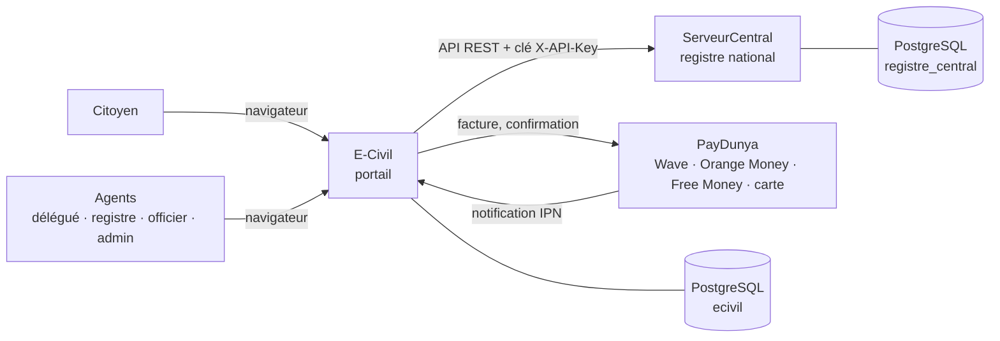
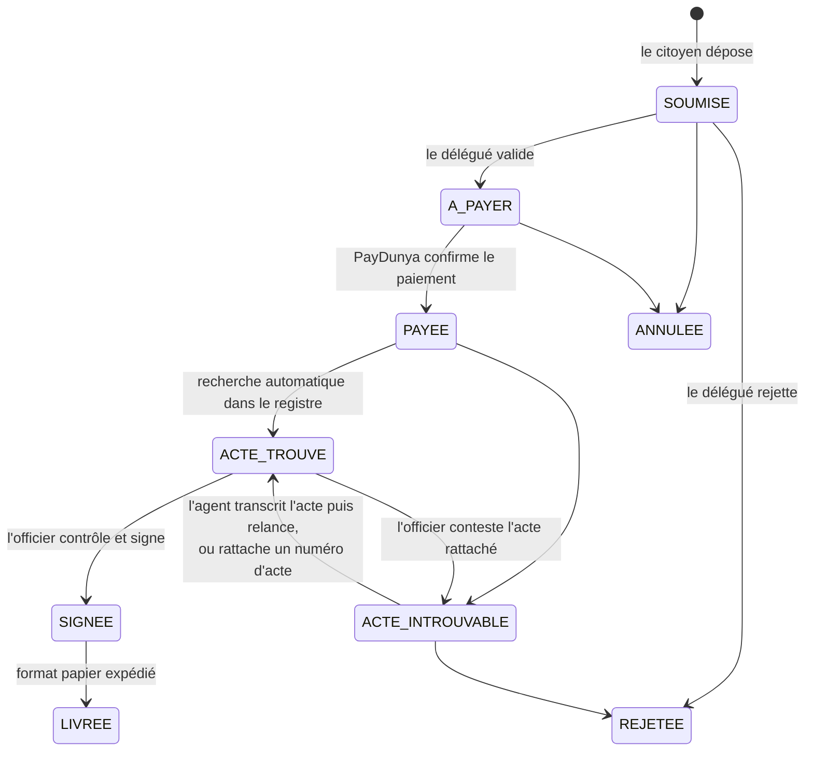

# E-Civil Sénégal

Plateforme de demande en ligne de documents d'état civil : extraits et copies littérales d'actes de
naissance, de mariage, de divorce et de décès.

Le dépôt contient deux applications Spring Boot (Java 17) :

| Dossier | Rôle | Port |
|---|---|---|
| [`E-Civil/`](E-Civil) | **Portail** : espace citoyen (demande, paiement, suivi, téléchargement) et back-office des agents | 8080 |
| [`ServeurCentral/`](ServeurCentral) | **Registre national** : API REST qui conserve les actes transcrits et répond aux recherches du portail | 8081 |



## Cycle de vie d'une demande



Chaque changement de statut est enregistré dans l'historique de la demande et déclenche un email au demandeur.

| Rôle | Ce qu'il fait |
|---|---|
| Citoyen | Dépose ses demandes, paie, suit l'avancement, télécharge le PDF signé |
| Délégué | Examine les demandes (validation ou rejet), expédie les documents papier |
| Agent du registre | Transcrit les actes des registres papier dans le registre national, traite les actes non retrouvés |
| Officier de l'état civil | Valide les transcriptions, contrôle et signe les documents |
| Administrateur | Crée les comptes agents, gère les rôles, les tarifs et le catalogue |

### Ce qui garantit l'authenticité d'un document

À la signature, le portail relit l'acte dans le registre, en **fige le contenu** (JSON enregistré avec la
demande), en calcule l'**empreinte SHA-256** et lui attribue un **code de vérification** unique. Ce code est
imprimé sur le PDF, avec un QR code. Sur `/verification/{code}`, n'importe qui peut afficher le contenu
authentique et le comparer au document présenté.

> Il s'agit d'une signature applicative, pas d'une signature électronique qualifiée au sens juridique.
> Pour une mise en production réelle, il faudrait la compléter par un certificat délivré par une autorité
> de certification reconnue.

## Démarrer en local

**Prérequis** : Java 17 ou plus récent, Maven 3.9, et PostgreSQL 14 ou plus récent (ou Docker).

1. **Créer les bases**. Avec Docker :

   ```bash
   docker compose up -d
   ```

   Sinon, dans `psql` : `CREATE DATABASE ecivil;` et `CREATE DATABASE registre_central;`.
   Les tables sont créées automatiquement par Flyway au premier démarrage.

2. **Configurer** : copier `.env.example` en `.env` à la racine du dépôt, puis le remplir. Il faut au minimum
   les mots de passe PostgreSQL, `REGISTRE_API_KEY` (32 caractères ou plus) et le compte administrateur.
   Le fichier `.env` est ignoré par git : **aucun secret ne doit être écrit dans le code**.

3. **Lancer le registre central, puis le portail**, chacun dans son propre terminal :

   ```bash
   cd ServeurCentral && mvn spring-boot:run
   ```

   ```bash
   cd E-Civil && mvn spring-boot:run
   ```

4. Ouvrir <http://localhost:8080>, se connecter avec le compte administrateur, puis créer les comptes agents
   dans **Administration → Comptes**.

### Paiement PayDunya

1. Créer un compte sur <https://app.paydunya.com>, puis une application en **mode test**.
2. Recopier la clé principale, la clé privée et le token dans `.env` (`PAYDUNYA_MASTER_KEY`,
   `PAYDUNYA_PRIVATE_KEY`, `PAYDUNYA_TOKEN`).
3. En local, la confirmation passe par le **retour navigateur** (`/paiements/retour`). Le portail interroge
   alors l'API PayDunya pour vérifier le statut et le montant.
4. La **notification IPN** (`/paiements/paydunya/ipn`) n'est joignable que si le portail est accessible depuis
   Internet. Il faut alors définir `ECIVIL_URL_PUBLIQUE` (en développement, avec un tunnel comme ngrok).
5. Pour la production, passer `PAYDUNYA_MODE=live` avec les clés de production.

Une demande n'est **jamais** marquée payée sur la seule parole du navigateur ou d'une notification :
l'API PayDunya doit confirmer le statut `completed` et le montant exact.

### Emails

Renseigner `MAIL_HOST`, `MAIL_USERNAME`, `MAIL_PASSWORD`. Avec Gmail, utiliser un
[mot de passe d'application](https://myaccount.google.com/apppasswords). Si `MAIL_HOST` est vide, les emails
ne sont pas envoyés et le journal l'indique.

## Tests

```bash
cd ServeurCentral && mvn test
```

```bash
cd E-Civil && mvn test
```

Les tests utilisent une base H2 en mémoire et ne demandent ni PostgreSQL ni accès réseau. Ils couvrent :

- l'authentification par clé API ;
- la numérotation sans doublon ;
- la recherche d'actes (accents, conjoint, critères contradictoires) ;
- les règles métier du registre ;
- le parcours complet d'une demande ;
- le refus d'un montant erroné et l'authentification de l'IPN ;
- les transitions interdites ;
- le contrôle d'accès par rôle et le cloisonnement entre citoyens ;
- le dialogue HTTP avec PayDunya.

## API du registre central (v1)

Toutes les routes exigent l'en-tête `X-API-Key`, sauf `/actuator/health`.

| Méthode | Route | Description |
|---|---|---|
| `POST` | `/api/v1/actes` | Transcrire un acte (numéro attribué automatiquement, ex. `N-1998-000042`) |
| `PUT` | `/api/v1/actes/{id}` | Corriger un acte saisi. Un acte validé n'accepte plus que des mentions |
| `POST` | `/api/v1/actes/{id}/validation` | Validation par un officier : l'acte devient délivrable |
| `GET` | `/api/v1/actes/{id}` · `/api/v1/actes/numero/{numero}` | Consulter un acte |
| `GET` | `/api/v1/actes?type=&statut=&nom=&page=` | Lister, filtrer et paginer |
| `POST` | `/api/v1/actes/recherche` | Rechercher un acte validé : `TROUVE`, `AMBIGU` ou `NON_TROUVE` |
| `GET` | `/api/v1/actes/statistiques` | Compteurs par statut et par type |

Les erreurs suivent le format RFC 7807 (`application/problem+json`).

## Note sur la version 1

Le code de la version initiale (servlets/JSP) reste disponible dans l'historique git, au commit `28d59f4`.
Le schéma de base a été entièrement repensé : il faut partir de bases **vides**. Les données de test de la
version 1 ne sont pas reprises.

La génération PDF utilise iText 8, distribué sous licence AGPL. Une diffusion commerciale nécessiterait une
licence iText ou une bibliothèque alternative (par exemple OpenPDF).
