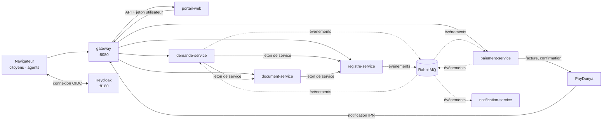
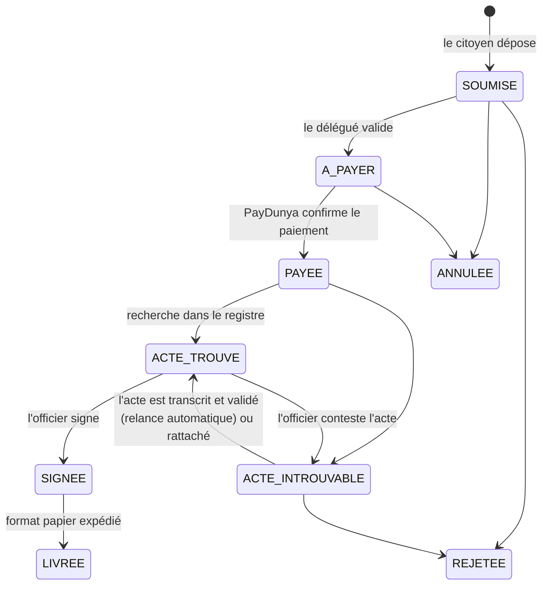

# E-Civil Sénégal

Plateforme de demande en ligne de documents d'état civil : extraits et copies littérales d'actes de
naissance, de mariage, de divorce et de décès, avec paiement en ligne (PayDunya) et documents signés
vérifiables par QR code.

Architecture : **microservices** communiquant par **événements** (RabbitMQ), chacun construit selon
l'**architecture hexagonale**, avec **Keycloak** pour l'identité et une **passerelle** comme point d'entrée unique.

## Vue d'ensemble



| Service | Rôle | Base | Port |
|---|---|---|---|
| `gateway` | Point d'entrée unique (Spring Cloud Gateway) | — | 8080 |
| `portail-web` | Pages des citoyens et des agents (Thymeleaf), client OIDC de Keycloak | — | 8090 |
| `demande-service` | Catalogue, dépôt et instruction des demandes, cycle de vie | `demande` | 8081 |
| `paiement-service` | Paiement PayDunya (Wave, Orange Money, Free Money, carte) | `paiement` | 8082 |
| `registre-service` | Registre national des actes : transcription, validation, recherche | `registre` | 8083 |
| `document-service` | Signature, PDF, vérification publique d'authenticité | `document` | 8084 |
| `notification-service` | Emails aux citoyens à chaque étape | `notification` | 8085 |

Chaque service possède **sa propre base** : aucun ne lit les données d'un autre, ils communiquent
uniquement par API et par événements.

## Architecture hexagonale

Chaque service est découpé de la même façon :

```
sn.etatcivil.<service>
├── domaine/           Java pur : entités, règles de gestion, machine à états (aucun framework)
├── application/
│   ├── port/entree/   cas d'usage offerts (interfaces)
│   ├── port/sortie/   besoins du service : stockage, autres services, événements (interfaces)
│   └── service/       implémentation des cas d'usage, toujours sans framework
├── adaptateur/
│   ├── entree/        REST, écoute RabbitMQ, tâches planifiées
│   └── sortie/        JPA, clients HTTP, PayDunya, outbox, email, PDF
└── configuration/     assemblage (Spring), transactions, sécurité
```

Ces règles sont **vérifiées à chaque build** par des tests ArchUnit (`socle/socle-tests`) : le domaine ne
dépend que de Java, l'application que du domaine, et les adaptateurs ne se connaissent pas entre eux.
Grâce aux ports, les cas d'usage se testent avec de simples implémentations en mémoire, sans base ni réseau.

Le **socle** commun contient :
- `socle-evenements` : les contrats des événements échangés ;
- `socle-messagerie` : l'outbox transactionnel et la consommation idempotente ;
- `socle-securite` : la lecture des rôles Keycloak et les jetons de service ;
- `socle-tests` : les règles ArchUnit.

## Événements et fiabilité

| Événement | Publié par | Écouté par | Effet |
|---|---|---|---|
| `demande.statut` | demande-service | notification-service, paiement-service | email au citoyen ; la demande devient payable |
| `paiement.confirme` | paiement-service | demande-service | la demande passe « payée », l'acte est recherché aussitôt |
| `registre.acte-valide` | registre-service | demande-service | les demandes dont l'acte manquait sont relancées automatiquement |

- **Outbox transactionnel** : un événement est enregistré dans la même transaction que la donnée métier,
  puis relayé vers RabbitMQ. Si le broker est arrêté, rien n'est perdu.
- **Consommation idempotente** : chaque événement a un identifiant, et un message reçu deux fois n'a
  d'effet qu'une fois.
- **File d'erreurs** : un message qui échoue après plusieurs tentatives est rangé dans `<service>.erreurs`
  au lieu d'être perdu.

## Cycle de vie d'une demande



| Rôle (Keycloak) | Ce qu'il fait |
|---|---|
| `CITOYEN` | Attribué automatiquement à l'inscription : dépose, paie, suit, télécharge |
| `DELEGUE` | Examine les demandes, expédie les documents papier |
| `AGENT_REGISTRE` | Transcrit les actes des registres papier, traite les actes non retrouvés |
| `OFFICIER` | Valide les transcriptions, contrôle et signe les documents |
| `ADMIN` | Tarifs et catalogue ; les comptes et les rôles se gèrent dans la console Keycloak |
| `SERVICE` | Comptes techniques des services qui en appellent d'autres |

## Catalogue des documents

19 documents, repris du catalogue de la version d'origine et limités à ce que délivre l'état civil. Chacun a
un **modèle** (ce qu'il contient) et, pour certains, une **origine exigée** de l'acte :

| Famille | Documents | Comment ils sont établis |
|---|---|---|
| Naissance | Extrait (avec ou sans filiation), copie littérale, jugement supplétif, transcription d'acte étranger | à partir de l'acte de naissance |
| Reconnaissance | Copie d'acte de reconnaissance (paternelle, maternelle, anticipée) | à partir de l'acte de reconnaissance |
| Mariage | Extrait, copie littérale, jugement supplétif, transcription, duplicata de livret de famille | le livret reprend l'acte de mariage et les naissances des enfants du couple |
| Divorce | Extrait d'acte de divorce | à partir de l'acte de divorce |
| Décès | Extrait, copie littérale, jugement supplétif, transcription | à partir de l'acte de décès |
| Certificats | Célibat, capacité matrimoniale, vie | à partir de l'acte de naissance **et** de la situation de la personne dans le registre |

- **Origine de l'acte.** Un acte est dressé sur déclaration ordinaire, en exécution d'un **jugement supplétif**
  ou par **transcription** d'un acte étranger ; l'agent en saisit les références. Les documents « jugement
  supplétif » et « transcription » ne retrouvent que les actes de cette origine.
- **Certificats.** registre-service établit la situation civile d'une personne : ses mariages (dissous ou non
  par un divorce ou le décès du conjoint) et son décès. Le certificat de célibat exige qu'aucun mariage ne
  soit inscrit, la capacité matrimoniale qu'aucun mariage ne soit en cours, le certificat de vie qu'aucun décès
  ne soit inscrit. Dans le cas contraire, la demande n'est jamais refusée automatiquement : un agent vérifie
  (homonymie, option de polygamie…), puis rattache l'acte ou rejette la demande. Le constat fait dans le
  registre est imprimé sur le certificat et couvert par l'empreinte.

**Authenticité.** À la signature, document-service relit l'acte dans le registre, en fige le contenu, en
calcule l'empreinte SHA-256 et lui attribue un code de vérification unique, imprimé avec un QR code sur
le PDF. Sur `/verification/{code}`, n'importe qui peut vérifier le document. Toute modification du contenu
enregistré est détectée. Il s'agit d'une signature applicative, pas d'une signature électronique qualifiée.

## Démarrer

> Première installation ? Suivez le **[guide pas à pas](docs/guide-demarrage.md)** : outils à installer,
> fichier `.env`, comptes agents, PayDunya en mode test, premier parcours et problèmes fréquents.

**Prérequis :** Java 17 ou plus récent et Docker Desktop (Maven est fourni par le wrapper `mvnw`).

1. Copier `.env.example` en `.env`, puis remplir chaque valeur (mots de passe, secrets, PayDunya).
   Le fichier `.env` est ignoré par git : aucun secret n'est écrit dans le code.
2. Construire les services :

   ```bash
   ./mvnw -DskipTests package
   ```

   (Windows : `.\mvnw.cmd -DskipTests package`.)

3. Tout démarrer :

   ```bash
   docker compose up --build
   ```

4. Ouvrir <http://localhost:8080>. Le compte administrateur (`ECIVIL_ADMIN_EMAIL`) doit changer son mot de
   passe à la première connexion. Les comptes agents se créent dans la console Keycloak
   (<http://localhost:8180>, realm `ecivil`), avec le rôle voulu, ou d'un coup pour la démonstration :
   `./scripts/agents-demo.sh <mot de passe>`.

| Adresse | Contenu |
|---|---|
| <http://localhost:8080> | Portail E-Civil (via la passerelle) |
| <http://localhost:8180> | Keycloak (console d'administration) |
| <http://localhost:15672> | Console RabbitMQ (pour voir passer les événements) |

### Mode démonstration

Avec `ECIVIL_MODE=demo` dans `.env`, registre-service ajoute au registre national 16 actes **fictifs**
(naissances, mariages, divorce, décès, reconnaissance, un acte par jugement supplétif, une transcription, dont
2 encore à valider), pour présenter la plateforme sans saisie préalable. Par exemple, une demande d'extrait de naissance pour **Ousmane Sarr**, né le 22/07/1995 à Thiès,
de Abdoulaye Sarr et Khady Faye, retrouve aussitôt l'acte `N-1995-000001` après le paiement.

Pour les autres documents : un certificat de célibat pour **Mame Diarra Gueye** (née le 09/01/2003 à
Saint-Louis), refusé pour **Babacar Mbaye** (marié) ; un livret de famille pour Babacar Mbaye et Seynabou Diouf
(deux enfants) ; un jugement supplétif de naissance pour **Mamadou Saliou Baldé** ; une transcription de mariage
pour **Aliou Faye** et Bineta Ndiaye ; une copie de reconnaissance pour **Fatou Gueye** (née le 05/12/2018).

Le jeu est chargé une seule fois, à la création de la base (`db/demo/V1000__actes_demo.sql`) : pour revenir à un
registre vide, repasser en `ECIVIL_MODE=production` et recréer les volumes (`docker compose down -v`).

### Paiement PayDunya

Créer une application en **mode test** sur <https://app.paydunya.com>, puis recopier la clé principale, la
clé privée et le token dans `.env`. Une demande n'est marquée payée que lorsque l'API PayDunya confirme le
statut et le montant exact. La notification IPN (`/api/paiements/paydunya/ipn`) n'est joignable que si la
plateforme est accessible depuis Internet (`ECIVIL_URL_PUBLIQUE`) ; en local, la confirmation se fait au
retour du navigateur.

### Emails

Renseigner `MAIL_HOST`, `MAIL_USERNAME` et `MAIL_PASSWORD` (pour Gmail : un mot de passe d'application).
Sans `MAIL_HOST`, notification-service journalise les messages sans les envoyer.

## Tests

```bash
./mvnw test
```

Les tests n'ont besoin ni de Docker ni du réseau (base H2 en mémoire, jetons Keycloak simulés). Pour
chaque service, ils couvrent le domaine en Java pur, les cas d'usage avec des ports en mémoire, l'API REST
avec le contrôle des rôles, l'idempotence des événements, l'outbox et les règles d'architecture.

## Historique

| Version | Architecture | Commit |
|---|---|---|
| 1 | Servlets/JSP + ServeurCentral (code du mémoire) | `28d59f4` |
| 2 | Monolithe Spring Boot + registre, simulations supprimées | `b58ab4b` |
| 3 | Microservices hexagonaux, événements, Keycloak (version actuelle) | — |

La génération PDF utilise iText 8 (licence AGPL). Une diffusion commerciale nécessiterait une licence iText
ou une bibliothèque alternative (par exemple OpenPDF).
